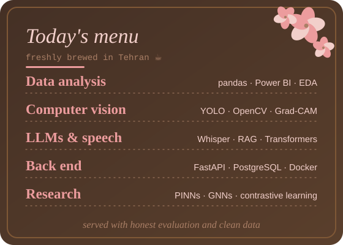

<p align="center">
  
</p>

<p align="center">
  <a href="https://github.com/ftharir"></a>
</p>

<p align="center">
  <a href="mailto:fatemeh.harirforoush04@gmail.com"></a>
  <a href="https://www.linkedin.com/in/fatemeh-harirforoush-01a15927b/"></a>
  <a href="https://github.com/ftharir?tab=repositories"></a>
</p>

<p align="center"></p>

## 🌸 About me

<table>
<tr>
<td width="58%" valign="top">

```js
const fatemeh = {
  role:     "AI Software Engineer · ML Engineer",
  degree:   "B.Sc. Computer Engineering (2026)",
  location: "Tehran, Iran",

  focus: [
    "Data analysis & data pipelines",
    "Computer vision",
    "LLMs, Transformers & speech",
  ],

  currently: [
    "Building an AI-powered data-labeling platform",
    "Research on predictive maintenance (paper under review)",
  ],

  loves: ["tidy datasets", "honest evaluation", "clean code"],
};
```

</td>
<td width="42%" valign="middle" align="center">



</td>
</tr>
</table>

## 🍵 What I work on

| 📊 Data analysis & ML | 👁️ Computer vision | 🗣️ Backend, LLMs & speech |
|---|---|---|
| Exploratory data analysis, cleaning and validation of messy data | Object detection and tracking (YOLO), medical image classification | Persian speech-to-text with Faster Whisper |
| Excel to Power BI pipelines with pandas | Hand-annotated datasets with LabelMe | FastAPI, PostgreSQL, Redis and Docker back ends |
| Honest model evaluation, leakage checks, tests | Explainable AI (Grad-CAM) | Telegram and Bale bots, RAG-ready knowledge bases |

## 🧁 Tech stack

<p align="center">
  
  
  
  
  
  
  
  
  
  
  <br>
  
  
  
  
  
  
  
  
  
  
</p>

<p align="center"></p>

## 🌷 Featured projects

<table>
<tr>
<td width="50%" align="center">
<a href="https://github.com/ftharir/industrial-gauge-localization"></a><br>
<sub>YOLOv5 finds analog pressure gauges · 435 hand-annotated frames · mAP@0.5 0.995</sub>
</td>
<td width="50%" align="center">
<a href="https://github.com/ftharir/cost-allocation-data-analysis"></a><br>
<sub>Data analysis pipeline: messy Excel files → clean, allocated dataset for Power BI · 30 tests</sub>
</td>
</tr>
<tr>
<td align="center">
<a href="https://github.com/ftharir/pharmacogenomics-ml-data-analysis"></a><br>
<sub>Drug-effect data analysis with SVM · finding and fixing data leakage</sub>
</td>
<td align="center">
<a href="https://github.com/ftharir/explainable-skin-disease-classification"></a><br>
<sub>ResNet18 + Grad-CAM on facial skin lesions · Streamlit demo · bachelor thesis</sub>
</td>
</tr>
<tr>
<td align="center">
<a href="https://github.com/ftharir/VoiceLedger"></a><br>
<sub>Bale bot + REST API: Persian voice reports → searchable knowledge base</sub>
</td>
<td align="center">
<a href="https://github.com/ftharir/ctc-captcha-recognition"></a><br>
<sub>CRNN + CTC reads 5-character captchas end to end</sub>
</td>
</tr>
<tr>
<td align="center">
<a href="https://github.com/ftharir/ml-playbook"></a><br>
<sub>Five end-to-end ML case studies: classification, regression, deep learning</sub>
</td>
<td align="center">
<a href="https://github.com/ftharir/telegram-services-platform"></a><br>
<sub>Async Telegram service platform: FastAPI, PostgreSQL, Redis, wallet and orders</sub>
</td>
</tr>
</table>

### A closer look

<table>
<tr>
<td width="50%" align="center">
<br>
<sub>Gauge detection on video</sub>
</td>
<td width="50%" align="center">
<br>
<sub>Cost allocation: direct vs shared costs per company</sub>
</td>
</tr>
<tr>
<td align="center">
<br>
<sub>Grad-CAM: where the skin classifier looks</sub>
</td>
<td align="center">
<br>
<sub>Pharmacogenomics data analysis: effect of genes and drugs</sub>
</td>
</tr>
</table>

<p align="center"></p>

## 📚 Experience

| When | What | Where |
|---|---|---|
| Aug 2026 – now | **AI Software Engineering Intern** · owner of an AI-powered, multimodal data-labeling platform (ASR, OCR, vehicle attributes; human-in-the-loop) | Generative-AI startup |
| Mar 2025 – Jun 2026 | **AI Researcher** · predictive maintenance with Transformers, contrastive learning, PINNs and diffusion models; manuscript under review at a Q1 journal | Sharif Center for Information Systems and Data Science |
| Jun 2024 – Feb 2025 | **Research Assistant, computer vision** · detection and tracking for quadcopters | Sharif University of Technology lab |
| Jul 2024 – Jan 2025 | **Research Assistant, neuroimaging** · mental-state estimation from fMRI with graph neural networks | School of AI, Sharif University of Technology |
| Dec 2023 – Sep 2024 | **Data Scientist Bootcamp** trainee, selected through the Hafez competition | Fanap |

**Education:** B.Sc. Computer Engineering, Science and Research University, Tehran (2022 – 2026); audited advanced AI and machine-learning courses at Sharif University of Technology.

## 📈 By the numbers

<p align="center">
  
</p>

<p align="center">
  
</p>

<p align="center"></p>
