<p align="center">
  
</p>

<p align="center">
  <a href="https://ftharir.github.io"></a>
  <a href="mailto:fatemeh.harirforoush04@gmail.com"></a>
  <a href="https://www.linkedin.com/in/fatemeh-harirforoush-01a15927b/"></a>
  <a href="https://github.com/ftharir?tab=repositories"></a>
</p>

## `~/about`

```python
class Fatemeh:
    role      = "AI Software Engineer · ML Engineer"
    degree    = "B.Sc. Computer Engineering (2026)"
    location  = "Tehran, Iran"

    focus     = ["data analysis & data pipelines", "computer vision", "LLMs, Transformers & speech"]
    building  = "an AI-powered, multimodal data-labeling platform"
    research  = "predictive maintenance with Transformers (paper under review)"
    values    = ["tidy datasets", "honest evaluation", "clean code"]
```

## `~/stack`

<p align="center">
  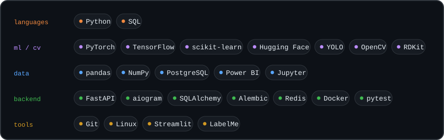
</p>

## `~/projects`

<table>
<tr>
<td width="50%"><a href="https://github.com/ftharir/industrial-gauge-localization">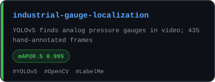</a></td>
<td width="50%"><a href="https://github.com/ftharir/cost-allocation-data-analysis">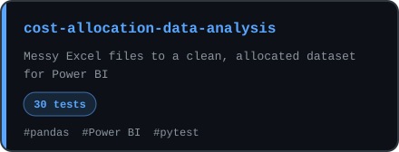</a></td>
</tr>
<tr>
<td><a href="https://github.com/ftharir/pharmacogenomics-ml-data-analysis">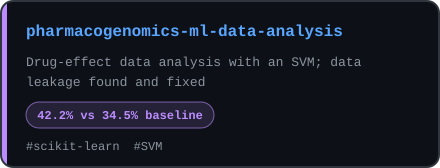</a></td>
<td><a href="https://github.com/ftharir/explainable-skin-disease-classification">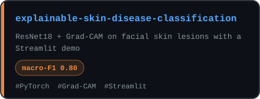</a></td>
</tr>
<tr>
<td><a href="https://github.com/ftharir/VoiceLedger">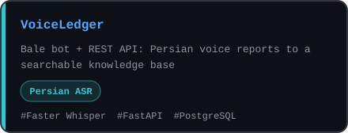</a></td>
<td><a href="https://github.com/ftharir/ctc-captcha-recognition">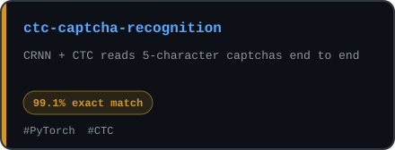</a></td>
</tr>
<tr>
<td><a href="https://github.com/ftharir/ml-playbook">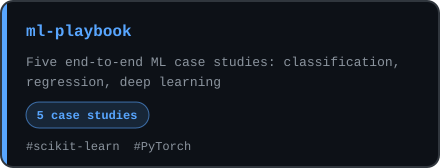</a></td>
<td><a href="https://github.com/ftharir/telegram-services-platform">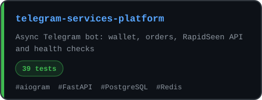</a></td>
</tr>
<tr>
<td><a href="https://github.com/ftharir/moleculenet-3d-structure-study">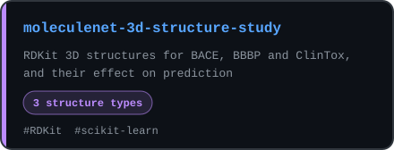</a></td>
<td><a href="https://github.com/ftharir?tab=repositories">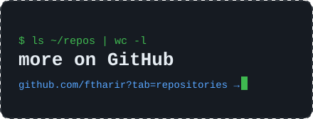</a></td>
</tr>
</table>

## `~/numbers`

<p align="center">
  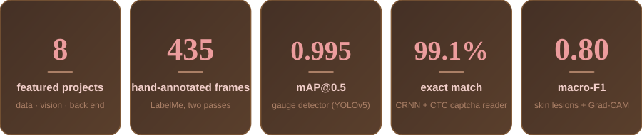
</p>

## `~/experience`

```text
2026-08 ─ now      AI Software Engineering Intern · Generative-AI startup
  │                owner of an AI-powered, multimodal data-labeling platform
  │                (ASR, OCR, vehicle attributes; human-in-the-loop)
  │
2025-03 ─ 2026-06  AI Researcher · Sharif Center for Information Systems and Data Science
  │                predictive maintenance: Transformers, contrastive learning, PINNs,
  │                diffusion models; manuscript under review at a Q1 journal
  │
2024-07 ─ 2025-01  Research Assistant, neuroimaging · School of AI, Sharif University of Technology
  │                mental-state estimation from fMRI with graph neural networks
  │
2024-06 ─ 2025-02  Research Assistant, computer vision · Sharif University of Technology lab
  │                detection and tracking for quadcopters
  │
2023-12 ─ 2024-09  Data Scientist Bootcamp · Fanap  (selected through the Hafez competition)

education          B.Sc. Computer Engineering, Science and Research University, Tehran (2022 – 2026)
                   audited advanced AI and machine-learning courses at Sharif University of Technology
```

## `~/github`

<p align="center">
  
  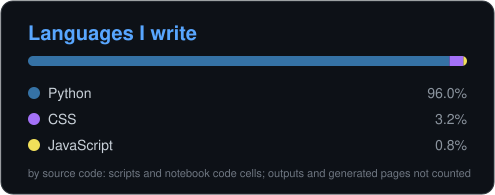
</p>

<p align="center">
  
</p>
